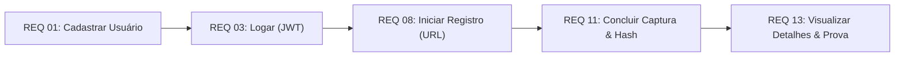

# 📋 Planejamento de Implementação — Sprint 30% dos Requisitos

> **Disciplina:** Engenharia de Software I (2026.2) — UFBA  
> **Docente:** Prof. Dr. Eduardo Almeida  
> **Sistema:** Veridit — Sistema de Registro de Provas Digitais na Web  
> **Documento:** Registro de Planejamento e Estratégia de Desenvolvimento  

---

## 1. Contexto e Objetivo

O **Trabalho III** tem como objetivo a implementação prática e funcional de **30% dos requisitos** definidos na arquitetura do sistema **Veridit**, elaborado no Trabalho II.

* **Critérios Mandatórios:**
  1. Lista documentada dos requisitos selecionados (30%).
  2. Implementação fiel à arquitetura proposta ou devidamente justificada através de **ADRs** criadas/alteradas exclusivamente em sala de aula nas sessões supervisionadas.
  3. Aplicação explícita dos **Princípios SOLID**, indicando onde foram aplicados e as razões arquiteturais.
  4. Repositório público com instruções no `README.md` de como rodar o sistema.
  5. Sistema **rodando** e demonstrável em 20 minutos de apresentação.

---

## 2. Requisitos Selecionados (30% do Escopo)

O documento arquitetural do Veridit lista **15 requisitos funcionais principais** (REQ 01 a REQ 15). Para cumprir os 30%, foram selecionados **5 requisitos** formando uma fatia vertical completa de valor (*Vertical Slice*):

### Detalhamento dos Requisitos

| ID | Requisito | Descrição Operacional | Componentes Arquiteturais |
|---|---|---|---|
| **REQ 01** | **Cadastrar usuário** | Cadastro de usuário comum e advogado com validação de unicidade (CPF, e-mail e OAB). | `C02` (Cadastro de Usuários), `C19` (PostgreSQL) |
| **REQ 03** | **Logar no sistema** | Autenticação por e-mail e senha com geração de token assinado JWT para controle de sessão sem estado. | `C03` (Autenticação e Sessão), `C17` (Validador JWT) |
| **REQ 08** | **Iniciar registro de conteúdo** | Submissão de URL para registro de prova digital por usuário autenticado. | `C10` (Gerenciador de Registros), `C01` (Portal Web) |
| **REQ 11** | **Concluir captura de tela** | Acionamento de navegador headless isolado (Puppeteer), geração de screenshot, coleta de metadados de rede (IP do servidor, timestamp UTC, cabeçalhos HTTP) e cálculo do hash SHA-256. | `C11` (Motor de Captura), `C12` (Integridade de Evidências), `C13` (Armazenamento) |
| **REQ 13** | **Visualizar detalhes do registro** | Exibição da prova coletada, manifesto de metadados e verificação de integridade do hash SHA-256 em tempo real. | `C14` (Consulta de Registros), `C12` (Integridade de Evidências) |

---

## 3. Estratégia de Arquitetura e Decisão Tecnológica

### 3.1. Arquitetura Baseada em Serviços com Bounded Contexts
A solução adota a **Arquitetura Baseada em Serviços** definida na **ADR 1**, mantendo o isolamento de domínio:
* **Módulo de Identidade (`identity`):** Autenticação, gestão de usuários e emissão de tokens. Banco: schema `identidade`.
* **Módulo de Registros (`records`):** Ciclo de vida da evidência, captura headless e integridade criptográfica. Banco: schema `registros`.
* **Frontend (`frontend`):** SPA React em TypeScript consumindo APIs REST com autenticação via cabeçalho `Authorization: Bearer <JWT>`.

### 3.2. Proposta de ADR a ser Registrada em Sala de Aula Supervisionada
> 📌 **Ponto de Ação Presencial:**  
> A arquitetura de referência sugeria Laravel para o serviço de identidade e Node.js para o serviço de registros. Para unificar o runtime em ambiente de desenvolvimento, evitar atrito com dependências não instaladas na máquina local (como PHP e extensões) e focar na entrega dos princípios SOLID com tipagem estática rigorosa, a equipe levará para a sessão supervisionada em sala de aula a aprovação da:
> 
> * **ADR 09:** *Adoção de Node.js + TypeScript em ambos os módulos de serviço (`identity` e `records`), mantendo o isolamento estrito de subdomínios, schemas separados no PostgreSQL e comunicação desacoplada via contratos de API.*

---

## 4. Aplicação dos Princípios SOLID

A estrutura de código foi projetada para que os 5 princípios de orientação a objetos sejam evidentes e demonstráveis na avaliação:

| Princípio | Padrão / Estrutura Adotada | Justificativa |
|---|---|---|
| **S** — *Single Responsibility* | Cada classe de caso de uso (`RegisterUserUseCase`, `CaptureEvidenceUseCase`, `VerifyIntegrityUseCase`) e serviço de infraestrutura possui uma única responsabilidade clara. | Alterações na lógica de captura não afetam o cálculo de hash nem a emissão de tokens. |
| **O** — *Open/Closed* | Interface `ICaptureStrategy` com a implementação `PuppeteerScreenshotStrategy`. | Novas formas de captura (como gravação de vídeo ou captura de página completa) podem ser adicionadas criando novas estratégias sem alterar a classe orquestradora. |
| **L** — *Liskov Substitution* | Implementações de `IStorageProvider` (`LocalStorageProvider`, extensível para `S3StorageProvider`). | Qualquer provedor de armazenamento pode substituir outro de forma transparente sem quebrar o orquestrador. |
| **I** — *Interface Segregation* | Interfaces granulares e focadas: `IIntegrityHasher`, `ITokenProvider`, `IUserRepository`, `IRecordRepository`. | Nenhum módulo cliente é obrigado a depender de métodos ou assinaturas de serviços que não utiliza. |
| **D** — *Dependency Inversion* | Casos de uso de alto nível dependem exclusivamente de interfaces (`IUserRepository`, `ICaptureStrategy`, `IStorageProvider`), recebendo as implementações concretas por injeção de dependência no construtor. | O domínio não depende de bibliotecas externas (Puppeteer, Postgres, Bcrypt, JsonWebToken). |

---

## 5. Cronograma de Execução

| Período | Meta / Entregável |
|---|---|
| **06/11** | Estruturação das pastas, arquivos de ambiente, Docker Compose, contratos de interface (SOLID) e planejamento. |
| **10/11 (Sessão Supervisionada)** | Homologação da ADR de unificação tecnológica em sala de aula; implementação e testes do módulo de Identidade (REQ 01 e 03). |
| **12/11 (Sessão Supervisionada)** | Conclusão do motor de captura e cálculo SHA-256 (REQ 08, 11 e 13); integração com a SPA React. |
| **13/11 a 16/11** | Bateria de testes de ponta a ponta, validação no Docker e preparação do roteiro de apresentação de 20 minutos. |
| **17 ou 19/11** | Apresentação oficial do sistema rodando para a banca avaliadora. |

