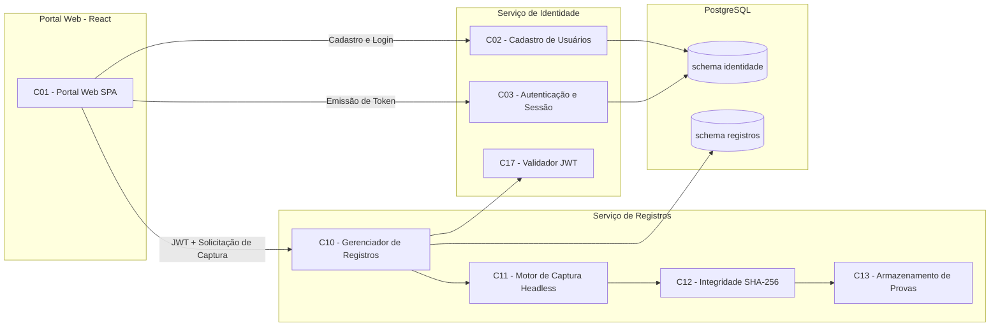

# Veridit — Sistema de Prova Digital na Web

> **Engenharia de Software I — 2026.2**  
> **Universidade Federal da Bahia (UFBA) — Instituto de Computação**  
> **Docente:** Prof. Dr. Eduardo Almeida  
> **Trabalho III:** Implementação de 30% dos Requisitos do Sistema Baseado em Arquitetura de Serviços  

---

## 📌 Sumário

1. [Sobre o Projeto](#-sobre-o-projeto)
2. [Escopo da Sprint (30% dos Requisitos)](#-escopo-da-sprint-30-dos-requisitos)
3. [Arquitetura de Referência e Componentes](#-arquitetura-de-referência-e-componentes)
4. [Aplicação dos Princípios SOLID](#-aplicação-dos-princípios-solid)
5. [Decisões Arquiteturais (ADRs)](#-decisões-arquiteturais-adrs)
6. [Instruções para Execução do Sistema](#-instruções-para-execução-do-sistema)
   - [Pré-requisitos](#pré-requisitos)
   - [Execução com Docker Compose (Recomendado)](#execução-com-docker-compose-recomendado)
   - [Execução Local](#execução-local)
7. [Mapeamento e Rastreabilidade](#-mapeamento-e-rastreabilidade)
8. [Equipe](#-equipe)

---

## 📖 Sobre o Projeto

O **Veridit** é uma plataforma web voltada para a coleta, validação e custódia de conteúdos publicados na internet para servir como **prova documental digital** com validade probatória em processos judiciais ou extrajudiciais.

O usuário (advogados ou cidadãos comuns) indica uma URL de interesse, e a plataforma efetua a navegação isolada através de um navegador automatizado (*headless*), capturando telas ou registrando a navegação, gerando um manifesto com metadados (data/hora em UTC, endereço IP, User-Agent, cabeçalhos de rede) e calculando o **hash criptográfico (SHA-256)** para assegurar a inviolabilidade e a cadeia de custódia da evidência.

---

## 🎯 Escopo da Sprint (30% dos Requisitos)

Conforme estabelecido nas instruções do **Trabalho III**, a equipe deve selecionar e implementar **30% dos requisitos funcionais** especificados no documento arquitetural recebido. O sistema totaliza 15 requisitos funcionais principais (REQ 01 ao REQ 15). Portanto, a sprint abrange **5 requisitos funcionais**, cobrindo uma jornada de valor fim a fim (*Vertical Slice*):

| ID | Requisito Funcional | Descrição | Componentes Envolvidos |
|---|---|---|---|
| **REQ 01** | **Cadastrar usuário** | Cadastro de usuário comum e advogado com validação de dados únicos (CPF/e-mail/OAB). | `C02` (Cadastro de Usuários), `C19` (Banco de Dados) |
| **REQ 03** | **Logar no sistema** | Autenticação com credenciais seguras, geração de token JWT assinado e controle de sessão. | `C03` (Autenticação e Sessão), `C17` (Validador JWT) |
| **REQ 08** | **Iniciar registro de conteúdo** | Solicitação de captura de prova digital a partir de uma URL informada pelo usuário. | `C10` (Gerenciador de Registros), `C01` (Portal Web) |
| **REQ 11** | **Concluir captura de tela** | Execução de captura automatizada em navegador headless isolado, registro de metadados e cálculo de hash SHA-256. | `C11` (Motor de Captura), `C12` (Integridade de Evidências) |
| **REQ 13** | **Visualizar detalhes do registro** | Exibição das evidências coletadas, metadados de auditoria e validação de integridade por conferência de hash. | `C14` (Consulta de Registros), `C12` (Integridade de Evidências) |

> 💡 *Nota: A seleção desses requisitos prioriza entregar o **diferencial central de negócio do Veridit** (coleta com garantia criptográfica de integridade de provas) associado à garantia do atributo explícito de **Segurança** (controle de acesso por autenticação).*

---

## 🏛 Arquitetura de Referência e Componentes

O projeto segue a **Arquitetura Baseada em Serviços** (*Service-Based Architecture*, Richards & Ford, Cap. 13), integrando serviços desacoplados em torno de seus respectivos subdomínios:

- **Frontend:** Portal Web SPA em **React** (`C01`).
- **Serviço de Identidade:** Gerenciamento de credenciais, usuários e emissão de JWTs (`C02`, `C03`, `C17`).
- **Serviço de Registros & Captura:** Gerenciador do ciclo de vida da prova, orquestrador de navegador automatizado e cálculo de hashes (`C10`, `C11`, `C12`, `C13`).
- **Banco de Dados:** **PostgreSQL** com isolamento por *schemas* (`identidade`, `registros`, `creditos`) conforme **ADR 4**.

---

## 💎 Aplicação dos Princípios SOLID

A implementação orienta-se estritamente pelos princípios de design orientado a objetos **SOLID**. A tabela abaixo detalha onde cada princípio foi empregado e sua fundamentação:

| Princípio | Onde foi aplicado no código | Justificativa de Engenharia |
|---|---|---|
| **S** — *Single Responsibility Principle* (Responsabilidade Única) | Separação estrita entre `CaptureService` (execução do browser), `HashIntegrityService` (cálculo/verificação SHA-256) e `EvidenceStorageService` (custódia de arquivos). | Cada classe possui apenas um único motivo para mudar, evitando que alterações na biblioteca de headless browser interfiram no algoritmo de hash ou no mecanismo de armazenamento. |
| **O** — *Open/Closed Principle* (Aberto/Fechado) | Criação da interface `ICaptureStrategy` implementada por `ScreenshotCaptureStrategy` (e extensível para `VideoCaptureStrategy` sem modificar o orquestrador). | O sistema permite adicionar novos tipos de captura e extração de evidências estendendo a arquitetura, sem necessidade de editar classes existentes de orquestração. |
| **L** — *Liskov Substitution Principle* (Substituição de Liskov) | Implementações de `IStorageProvider` (`LocalStorageProvider`, `CloudStorageProvider`) e de `ICaptureStrategy`. | O orquestrador de registros aceita qualquer subtipo de `IStorageProvider` ou `ICaptureStrategy` sem quebras de comportamento ou necessidade de checagens de tipo em tempo de execução. |
| **I** — *Interface Segregation Principle* (Segregação de Interfaces) | Criação de interfaces específicas e granulares como `IIntegrityHasher`, `IAuthTokenVerifier` e `IEvidenceRepository`. | Componentes clientes não são forçados a depender de contratos inflados com métodos que não utilizam; o validador de token, por exemplo, não depende da lógica de cadastro de usuário. |
| **D** — *Dependency Inversion Principle* (Inversão de Dependência) | Controladores e Casos de Uso dependem exclusivamente de abstrações/interfaces (portas) e não de implementações concretas (drivers externos). | Módulos de alto nível de negócio não conhecem bibliotecas de infraestrutura (como Puppeteer, bcrypt ou drivers de banco), as quais são injetadas via construtores. |

---

## ⚖️ Decisões Arquiteturais (ADRs)

As decisões de arquitetura de software seguem as ADRs homologadas na documentação do sistema:

- **ADR 1:** Estilo arquitetural baseado em serviços.
- **ADR 2:** Autenticação baseada em JSON Web Token (JWT).
- **ADR 3:** Características prioritárias: Segurança, Integridade dos Dados, Confiabilidade em Transações e Escalabilidade.
- **ADR 4:** Banco de dados relacional compartilhado com isolamento por schemas (`identidade`, `creditos`, `registros`).
- **ADR 5:** Distribuição de autorização por tokens JWT sem dependência de estado compartilhado síncrono.
- **ADR 6:** Interface Web do usuário construída com React (SPA).
- **ADR 7:** Garantia de integridade das evidências digitais através de HASH SHA-256 e manifesto de metadados.
- **ADR 8:** Notificações e e-mails centralizados de forma assíncrona.

> ⚠️ **Atenção quanto a desvios arquiteturais:** Conforme as regras da disciplina, quaisquer alterações, adições ou desvios em relação às ADRs homologadas só podem ser propostos, discutidos e validados **presencialmente em sala de aula nas sessões supervisionadas**, devendo conter o "de acordo" da equipe que as formulou.

---

## 🚀 Instruções para Execução do Sistema

### Pré-requisitos
- [Git](https://git-scm.com/)
- [Docker](https://www.docker.com/) e [Docker Compose](https://docs.docker.com/compose/) (versão 2.x ou superior)
- *Ou para execução local:* [Node.js](https://nodejs.org/) (v18+) e [PostgreSQL](https://www.postgresql.org/) (v14+)

---

### Execução com Docker Compose (Recomendado)

1. Clone o repositório:
   ```bash
   git clone <URL_DO_REPOSITORIO>
   cd <NOME_DO_DIRETORIO>
   ```

2. Configure as variáveis de ambiente (se necessário, copie o arquivo de exemplo):
   ```bash
   cp .env.example .env
   ```

3. Construa as imagens e inicie os serviços:
   ```bash
   docker compose up --build
   ```

4. Acesse as aplicações:
   - **Frontend (Web App):** `http://localhost:3000`
   - **API / Gateway:** `http://localhost:8000`

---

### Execução Local

*(As etapas detalhadas de instalação de dependências e inicialização dos serviços individuais serão descritas conforme o código-fonte for disponibilizado no repositório).*

---

## 📊 Mapeamento e Rastreabilidade



---

## 👥 Equipe


- Athur 
- Gabriel
- Gustavo
- Thales

